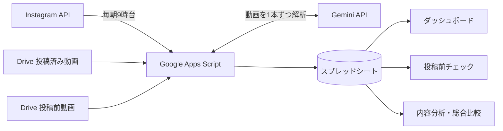

# Reels Insight

Instagramリールを「数値」と「動画の中身」の両方から分析し、投稿前の改善までつなげる仕組みです。
Googleスプレッドシート上で動き、投稿後の振り返りと投稿前のAIチェックを一つの流れで扱います。

このリポジトリは、その仕組みを紹介するポートフォリオ用のデモページです。

- **デモページ**：https://yumeyume90.github.io/reels-insight/
- **デモ用スプレッドシート（閲覧のみ）**：https://docs.google.com/spreadsheets/d/1Q7sIi8zFJferLm53_HyqyKp10LjwlVP_ZbwjlQ6jSz8/edit

> 掲載しているアカウント「こむぎとあお」、投稿、数値、AIの解析結果はすべてデモ用の架空データです。

---

## 解決したかった課題

- インサイト画面では数値は見られても、冒頭3秒やCTAが結果にどう効いたかが分からない
- 振り返りが手作業の転記と比較表づくりになり、投稿数が増えるほど続かない
- 改善できるのは投稿した後だけで、出す前の動画を客観的に見る手段がない

## できること

| 機能 | 内容 |
| --- | --- |
| 数値の自動取得 | Instagram APIから再生・リーチ・保存・シェア・平均視聴秒・スキップ率を毎朝取得し、日次で記録 |
| ダッシュボード | 全体の数値、投稿別ランキング、自動分析サマリー、次のアクションを表示 |
| 投稿済み動画のAI解析 | Driveに置いた動画をGeminiが解析し、冒頭3秒・テロップ・音声・CTA・強み・弱み・改善案を記録 |
| 内容×数値の分析 | テーマ・フック型・形式ごとに数値を比較し、上位と下位の違いから次の仮説を出す |
| 投稿前チェック | 投稿前の動画を採点し、「投稿推奨／軽微修正／要改善／再構成推奨」の判定と改善案を返す |
| 初速の比較 | 24時間・72時間・7日付近の実測再生数を比較（日数で割った推計ではなく実測値） |

## 使用技術

| 分類 | 技術 |
| --- | --- |
| データ取得 | Instagram Graph API（Instagram API with Instagram Login） |
| 動画解析 | Gemini API（映像・音声・テロップのマルチモーダル解析、構造化JSON出力） |
| 処理・自動実行 | Google Apps Script（時間主導型トリガー、カスタムメニュー） |
| データ保存・表示 | Google スプレッドシート、Google ドライブ |
| 機密情報の管理 | Apps Script のプロパティサービス（トークン・APIキーをセルやログに出さない） |
| デモページ | HTML / CSS / JavaScript（ライブラリなし）、GitHub Pages |
| 開発 | AIコーディングエージェント（Codex）との協働開発 |

## 構成

### スプレッドシートの構成

| シート | 役割 |
| --- | --- |
| ダッシュボード | 全体状況、ランキング、改善提案 |
| リール一覧 | 投稿情報と手入力項目（テーマ、動画尺、フォロー増加など） |
| 動画AI解析 | 投稿済みリールの映像・構成・CTA・改善案 |
| 投稿前チェック | 投稿前動画の採点、判定、強み、弱み、改善案 |
| 内容分析／24本総合比較 | テーマ・構成ごとの比較と、上位・下位の違い |
| 日次データ／実行ログ／自動分析 | 内部処理用（通常は非表示） |

### 主な指標

| 指標 | 定義 |
| --- | --- |
| 保存率 | 保存数 ÷ リーチ |
| シェア率 | シェア数 ÷ リーチ |
| フォロー獲得率 | フォロー増加数 ÷ リーチ |
| 反応率 | 総インタラクション ÷ リーチ |
| バズ実績スコア | 再生・保存率・シェア率・フォロー獲得率・冒頭離脱から算出する、同じアカウント内の相対指標 |
| 内容品質スコア | AIによる動画評価（フック・わかりやすさ・視聴維持設計・保存誘発・シェア誘発）をもとにした指標 |

スコアはInstagram公式の評価ではなく、同じアカウント内で投稿を比べて改善するための指標です。

## 設計で気をつけたこと

- **AIの判定は下書きとして扱う**：テロップ内の数字を読み違えるケースがあったため、強み・弱みの根拠を人が確認する運用にした
- **取得できない値は推測で埋めない**：APIで取れない指標は「未取得」と明記し、手入力の列を用意。空欄ならスコア計算から外す
- **失敗する前提で組む**：動画は1本ずつ処理し、試行回数とエラーを記録して次回の定期実行で再試行する
- **ふだん使う道具の中で完結させる**：運用担当者が新しい画面を覚えなくていいよう、スプレッドシートを画面として使う

## 今後の拡張（企業で使う場合）

| 段階 | 対象 | 内容 |
| --- | --- | --- |
| Phase 1（現在） | 個人・小規模店舗、1アカウント | スプレッドシート版。初期費用はGemini APIの従量分のみ |
| Phase 2 | 運用代行会社・複数ブランド | クライアントごとのシート自動生成、閲覧権限の分離、月次レポートの自動作成 |
| Phase 3 | チームで運用する企業 | Webアプリ化（管理画面・データベース・ログインと権限・競合比較・Slack通知） |

## 補足

- このリポジトリにはデモページのみを置いています。Apps Scriptのソースコードは含みません。
- デモ用スプレッドシートは閲覧専用です。
